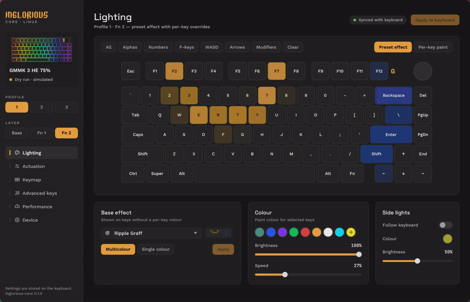

# Inglorious Core Linux

Unofficial native Linux configurator for the **Glorious GMMK 3 HE 75% wired ANSI**
keyboard (USB `342d:e3de`), packaged as an Omarchy plugin: a bar icon opens the app,
and the app follows your Omarchy theme. The protocol was re-implemented by reading how
the official app talks to the board; see [NOTES.md](NOTES.md).

> Not affiliated with, endorsed by or supported by Glorious. Glorious, Glorious Core
> and GMMK are trademarks of their owner and are used here only to say which keyboard
> this works with.



## What works

Tested on a real board: reading the device, lighting presets, per-key RGB, global
actuation and rapid trigger. The base-effect previews in the app are drawn by the
app and only approximate what the firmware shows.

Not yet tried on hardware: keymap, advanced keys (DKS, mod-tap, toggle, macros),
debounce, sleep, calibration and factory reset. The board keeps its settings in
flash, so treat those as experimental. Nothing is written until you press Apply.

## Install on Omarchy

```sh
sudo pacman -S --needed rust
omarchy plugin add https://github.com/tg5ee/inglorious-core-linux --enable
~/.config/omarchy/plugins/io.github.tg5ee.inglorious-core-linux/install.sh
```

`install.sh` builds the app (into `~/.cache/inglorious-core`), installs
`~/.local/bin/inglorious-core` and an app-launcher entry, and asks for sudo once to
install `/etc/udev/rules.d/70-glorious.rules`, which lets your login session open the
keyboard without root. Unplug and replug the keyboard afterwards. Run it again after
`omarchy plugin update` to rebuild.

## Remove

```sh
~/.config/omarchy/plugins/io.github.tg5ee.inglorious-core-linux/uninstall.sh
omarchy plugin remove io.github.tg5ee.inglorious-core-linux
```

Your saved settings in `~/.config/glorious-core-rs` are kept; delete that folder too
if you want them gone. Settings already on the keyboard stay on the keyboard.

## Dependencies

Rust/Cargo to build. At runtime: `hidapi` through the kernel hidraw interface (no
extra package), and `hyprctl`, `jq` and `notify-send` for the bar icon, all part of
Omarchy. Fonts are Space Grotesk, Work Sans and JetBrains Mono (SIL OFL 1.1), plus
Mark Cuda's [Omarchy Font](https://github.com/markcuda/Omarchy-Font) (MIT) for the
wordmark, whose extra letters come from the FIGlet font Delta Corps Priest 1 by
CoSMiC cHiLD.

## Build

Requires Rust/Cargo, a C toolchain, pkg-config, libudev development files and the
Wayland/X11 development libraries used by eframe. On Arch the package names are
`rust`, `cargo`, `base-devel`, `pkgconf`, `systemd-libs`, `wayland`, `libxkbcommon`,
`libx11`, `libxcursor`, `libxi`, and `libxrandr`. Cargo.lock pins the dependency versions.

```sh
cargo build --release
cargo test
cargo clippy --all-targets -- -D warnings
```

## Try without touching hardware

```sh
./target/release/inglorious-core --dry-run info
./target/release/inglorious-core --dry-run profile 2
./target/release/inglorious-core --dry-run effect 6 50 50 b48228
GLORIOUS_CORE_DRY_RUN=1 ./target/release/inglorious-core info
```

Dry-run never enumerates or opens HID devices and never saves state. Every TX
line contains all 65 bytes, starting with the zero report ID. Read replies are
synthetic zero values, **not hardware observations**. CLI profile numbers are
1–3; effect numbers are the original UI values (0–18), not wire opcodes.
`effect` affects the main preset of the currently active board profile/layer.
`profile` also reapplies saved global/per-key actuation and main/side presets.

## Device permissions (manual install)

The supplied rule grants access to Glorious hidraw devices for the active local
login session. It does not grant world-writable access. The following first
command needs sudo to copy the rule into system configuration; the second needs
sudo to reload udev's rules. They do not apply keyboard settings.

```sh
sudo install -m 0644 packaging/70-glorious.rules /etc/udev/rules.d/70-glorious.rules
sudo udevadm control --reload-rules
```

Then unplug/replug the keyboard so udev applies the rule. Do not run the app as
root. To remove the rule later, remove that installed file with administrator
privileges and reload udev again.

## GUI (launch manually)

```sh
./target/release/inglorious-core --dry-run
# After reviewing NOTES.md, omit --dry-run for real device access.
```

Device reads are explicit; startup sends no commands. Edit settings, then press
Apply. The keyboard grid supports selection and RGB painting; scrolling exposes
its full width. Advanced bindings accept four keycode slots. Macro input is one
`KeyName down|up delay_ms` event per line. Key names match the KeyCodeMapping table
(e.g. `KeyA`, `ControlLeft`, `ArrowUp`). A macro ID is shared by the board: reusing
an ID replaces that macro for all bindings that reference it.

State is kept in `$XDG_CONFIG_HOME/glorious-core-rs/state.json` (normally
`~/.config/glorious-core-rs/state.json`), with timestamped backups before replacement.
Successful Apply saves the associated settings; unrelated draft edits are not
saved. Board write failure leaves previous saved state intact and reports that
the board may have received part of the batch. State-file failure after a device
write cannot undo the device write. No existing keyboard settings can be imported
except active profile/layer, firmware versions and USB sleep timeout.

Factory reset requires typing `RESET`. Every individual calibration stage
requires typing `CALIBRATE` again. Neither operation runs automatically, nor is
there a CLI path for either. The app does not guide physical calibration motions;
use a verified procedure for this exact board. Reset retains local remembered
settings so they can be restored deliberately; activation can reapply them.
